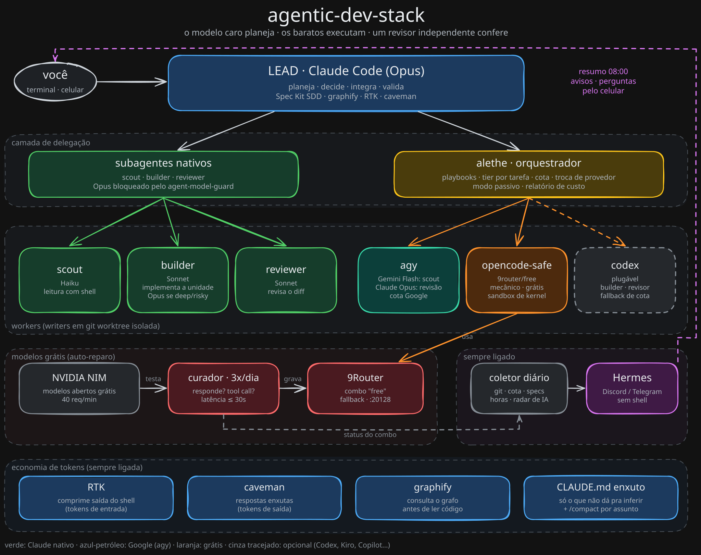
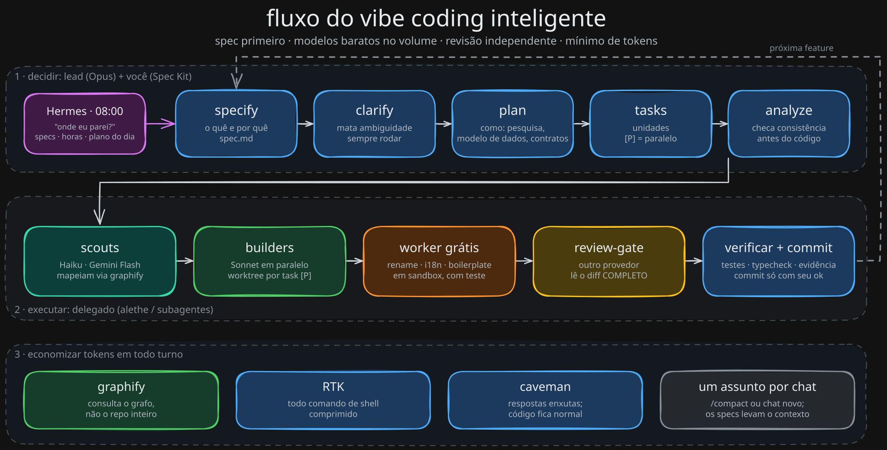

# agentic-dev-stack: vibe coding inteligente com Claude Code

[](https://github.com/Gildaciolopes/agentic-dev-stack/actions/workflows/ci.yml)
[](https://www.npmjs.com/package/agentic-dev-stack)


[](LICENSE)

> **Pare de usar um agente de IA por vez.** Um setup pronto para o Claude Code:
> - o modelo caro (Opus) planeja;
> - os baratos e grátis executam;
> - um revisor de outro provedor confere o diff;
> - todo turno gasta o mínimo de tokens.
>
> Inclui desenvolvimento guiado por spec com o GitHub Spec Kit, economia de tokens com caveman + RTK + graphify, orquestração multi-agente com alethe, segredos protegidos por sandbox de kernel, modelos grátis com auto-reparo via 9Router e um assistente sempre ligado (Hermes) no Discord ou Telegram. **Um comando no macOS, Linux e Windows.**

**🇺🇸 [Read in English](README.md)** · 📘 **[Guia do vibe coding inteligente](docs/pt-BR/00-vibe-coding-inteligente.md)** · 🧩 **[Templates de CLAUDE.md / AGENTS.md](templates/pt-BR/)**

```bash
npx agentic-dev-stack install --all
```

---

## Por quê

| Sem o stack | Com o stack |
|---|---|
| Um agente por vez, e **você** vira o gargalo | O lead planeja e dispara workers em paralelo, cada um numa git worktree isolada |
| Subagentes herdam o Opus sem você perceber | Um hook **bloqueia** subagente em Opus; o padrão vira Sonnet; a leitura vai para Haiku/Gemini |
| A cota do Claude acaba no meio do dia | Leitura pesada vai para a cota do Google (agy); edição mecânica vai para modelos grátis (NVIDIA via 9Router) |
| "Modelo grátis" quebra toda semana (410, 404, timeout) | Um curador testa os modelos 3x/dia e reescreve o combo sozinho |
| Saída de terminal e contexto inflando a cada turno | O RTK comprime o shell, o caveman corta a resposta e o graphify substitui a leitura ampla |
| Regras no CLAUDE.md que o modelo ignora | Regras viram enforcement: hook, sandbox de kernel, política do orquestrador |
| Sem spec, prompt gigante, diff aceito no escuro | Spec Kit SDD: specify → clarify → plan → tasks → analyze → implement → review → verificar |
| Você só sabe o que aconteceu abrindo o notebook | O Hermes manda resumo diário + plano do dia no Discord/Telegram |

## Arquitetura



<sub>Fonte editável: [`docs/assets/architecture.pt-BR.excalidraw`](docs/assets/architecture.pt-BR.excalidraw) (abre em excalidraw.com).</sub>

## O fluxo



O guia completo, **[Vibe coding inteligente: o guia completo](docs/pt-BR/00-vibe-coding-inteligente.md)**, cobre:
- como caveman, RTK, graphify e Spec Kit SDD se encaixam;
- um dia de trabalho, passo a passo;
- padrões de prompt e anti-padrões;
- checklists.

## Quem faz o quê

| Peça | Papel | Por quê |
|---|---|---|
| **Claude Code (Opus)** | Lead: planeja, decide, integra, valida | Melhor raciocínio, gasto só onde importa |
| **Sonnet** (`builder`) | Implementa unidades planejadas; Opus só nas `deep`/`risky` | Qualidade alta a custo médio |
| **Haiku** (`scout`) | Leitura e busca com shell | Barato e rápido |
| **agy · Gemini Flash** | Scout de leitura pesada | Gasta a cota do Google, não a do Claude |
| **agy · Claude Opus** / **Codex** | Revisão independente caçando bugs | Outro provedor é uma segunda opinião de verdade |
| **OpenCode + 9Router `free`** | Edição mecânica validada por teste | Custo zero; worktree isolada + sandbox de kernel |
| **alethe** | Orquestrador: playbooks, modelo por tarefa, cota, troca de provedor, relatório de custo | Transforma "use mais agentes" num plano reproduzível |
| **GitHub Spec Kit** | Desenvolvimento guiado por spec | O `tasks.md` vira as unidades paralelas |
| **graphify** | Grafo de conhecimento do código | Os scouts consultam o grafo em vez de ler o repo |
| **RTK** | Comprime a saída do shell | 15–30% menos tokens de entrada, transparente |
| **caveman** | Respostas enxutas | Menos tokens de saída e menos contexto relido |
| **Hermes Agent** | Assistente sempre ligado (sem shell) | Resumo, avisos e perguntas pelo celular |
| **agent-model-guard** | Hook que nega subagente em Opus | Regra em texto não funciona; enforcement funciona |
| **opencode-safe** | Sandbox de kernel que nega `.env` e chaves | Modelo grátis + acesso a arquivo = risco de vazamento |

Detalhes: [docs/pt-BR/01-arquitetura.md](docs/pt-BR/01-arquitetura.md).

## Instalação

| Método | Comando |
|---|---|
| **npx (qualquer SO)** | `npx agentic-dev-stack install --all` |
| **macOS / Linux** | `git clone https://github.com/Gildaciolopes/agentic-dev-stack && cd agentic-dev-stack && ./install.sh --all` |
| **Windows (PowerShell)** | `git clone https://github.com/Gildaciolopes/agentic-dev-stack; cd agentic-dev-stack; .\install.ps1 --all` |

Em vez de `--all`, dá para escolher as fases: `--core`, `--workers`, `--free-models`, `--extras`, `--hermes`. Use `--dry-run` para ver antes o que seria feito. O instalador:
- pode rodar de novo sem duplicar nada;
- faz backup de toda config que altera;
- nunca apaga conteúdo seu.

Depois, ligue cada projeto e confira se está tudo certo:

```bash
npx agentic-dev-stack add-project ~/projetos/meu-app --lang pt-BR
npx agentic-dev-stack doctor
```

Pré-requisitos: Node ≥ 18, git e Claude Code. O Python ≥ 3.9 também é necessário para o alethe, o curador e o coletor. Detalhes por SO e os passos manuais (logins, chaves) estão em [docs/pt-BR/02-instalacao.md](docs/pt-BR/02-instalacao.md).

| Plataforma | Suporte |
|---|---|
| macOS | Completo (launchd, `sandbox-exec` no worker grátis) |
| Linux | Completo (crontab/systemd, sandbox bubblewrap) |
| Windows | Core, workers, alethe, 9Router e Agendador de Tarefas. O worker grátis vem desligado (não há sandbox de kernel; use WSL2). Hermes via WSL2 |

O CI roda os testes e uma instalação `--core` de verdade no **Ubuntu, macOS e Windows (PowerShell)**, em Node 20 e 22.

## Templates para os seus projetos

- [`templates/pt-BR/project/CLAUDE.md`](templates/pt-BR/project/CLAUDE.md): CLAUDE.md inicial com SDD, economia de tokens, delegação e definição de pronto.
- [`templates/pt-BR/project/AGENTS.md`](templates/pt-BR/project/AGENTS.md): versão para outros agentes (Codex, OpenCode, Antigravity, Cursor), com o contrato de worker.
- As versões em inglês estão em [`templates/project/`](templates/project/).

## Hermes: o seu assistente de dev sempre ligado

Os scripts coletam os dados e o Hermes resume. Toda manhã chega um resumo com:
- status dos modelos grátis, uso de tokens e updates disponíveis;
- progresso do Spec Kit e radar de IA;
- o que você fez ontem e horas por projeto;
- **3 prioridades do dia**.

A documentação traz ainda 10 receitas produtivas: triagem de CI, uptime/SSL, CVEs da semana, inbox pelo celular que vira task, horas faturáveis, release notes para o cliente e mais. Funciona no Discord ou no Telegram. → [docs/pt-BR/06-hermes.md](docs/pt-BR/06-hermes.md)

## Documentação

| | Português | English |
|---|---|---|
| 0 | [Vibe coding inteligente: o guia completo](docs/pt-BR/00-vibe-coding-inteligente.md) | [Smart vibe coding guide](docs/00-smart-vibe-coding.md) |
| 1 | [Arquitetura](docs/pt-BR/01-arquitetura.md) | [Architecture](docs/01-architecture.md) |
| 2 | [Instalação (macOS, Linux, Windows)](docs/pt-BR/02-instalacao.md) | [Installation](docs/02-installation.md) |
| 3 | [alethe: orquestração](docs/pt-BR/03-alethe.md) | [alethe](docs/03-alethe.md) |
| 4 | [Codex e outros CLIs](docs/pt-BR/04-codex-e-outros-clis.md) | [Codex and other CLIs](docs/04-codex-and-other-clis.md) |
| 5 | [Modelos grátis: 9Router + curador](docs/pt-BR/05-modelos-gratis.md) | [Free models](docs/05-free-models.md) |
| 6 | [Hermes + 10 usos](docs/pt-BR/06-hermes.md) | [Hermes + 10 use cases](docs/06-hermes.md) |
| 7 | [Segurança: sandbox, segredos, auditoria](docs/pt-BR/07-seguranca.md) | [Security](docs/07-security.md) |
| 8 | [Troubleshooting](docs/pt-BR/08-troubleshooting.md) | [Troubleshooting](docs/08-troubleshooting.md) |
| 9 | [Manutenção](docs/pt-BR/09-manutencao.md) | [Maintenance](docs/09-maintenance.md) |

## Perguntas frequentes

**O que é "vibe coding inteligente"?**
Você comanda a intenção e as decisões; os agentes digitam. "Inteligente" quer dizer: spec primeiro, modelos baratos no volume, revisão independente, verificação antes do "pronto" e mínimo de tokens. Veja o [guia](docs/pt-BR/00-vibe-coding-inteligente.md).

**Como economizar tokens no Claude Code?**
Empilhe quatro coisas:
1. RTK, para a saída do shell;
2. caveman, para as respostas;
3. graphify, para a leitura de código;
4. um CLAUDE.md enxuto, com um assunto por chat.

Depois, pare de pagar preço de Opus por leitura e boilerplate: delegue isso a Haiku, Gemini, Sonnet e modelos grátis.

**Dá para usar modelos grátis com o Claude Code?**
Sim, como workers: OpenCode + 9Router com modelos grátis da NVIDIA NIM. O curador mantém os modelos funcionando, e o sandbox garante que eles nunca vejam os seus segredos.

**Como rodar vários agentes do Claude Code em paralelo?**
De duas formas: subagentes nativos (`scout`/`builder`/`reviewer`) com isolamento por worktree, ou playbooks do alethe como `parallel-worktrees` para as tasks `[P]` do Spec Kit.

**Funciona com Codex, Gemini, Kiro ou Copilot CLI?**
O Codex é provedor nativo do alethe (`WITH_CODEX=1`); os outros entram como workers customizados. Veja [docs/pt-BR/04](docs/pt-BR/04-codex-e-outros-clis.md).

**Funciona no Windows?**
Sim, para o core, os workers, a orquestração e os agendamentos (PowerShell, Agendador de Tarefas). O worker grátis precisa de sandbox de kernel, então no Windows rode ele no WSL2.

**É seguro?**
- As peças de terceiros foram auditadas e fixadas numa versão revisada.
- O worker grátis é bloqueado no kernel de ler segredos.
- O Hermes roda sem shell.

Veja [docs/pt-BR/07-seguranca.md](docs/pt-BR/07-seguranca.md).

## Princípios

1. **Plan big, execute small:** modelo forte nas decisões, barato no volume.
2. **Delegar só quando compensa:** tarefa pequena ou acoplada fica com o lead.
3. **Enforcement em vez de instrução:** hook, sandbox e política, não frase no CLAUDE.md.
4. **Segredo nunca sai da máquina.**
5. **Determinístico onde der:** scripts coletam e decidem; modelos resumem e raciocinam.
6. **Auditar antes de instalar:** código de terceiro é lido e fixado numa versão.

## Contribuindo

Issues e PRs são bem-vindos: novos adaptadores de worker, sandboxes para Linux e Windows, receitas para o Hermes, traduções. Rode `npm test` antes de abrir o PR.

## Licença

MIT. As ferramentas de terceiros mantêm as próprias licenças.
