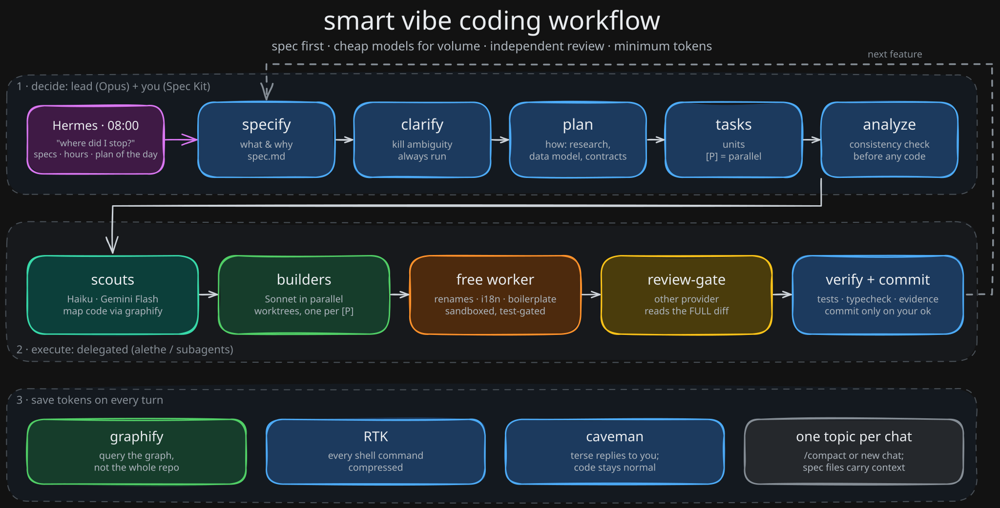

# Smart vibe coding: the complete guide

> You steer intent and decisions. Agents type. This guide is a real daily workflow for Claude Code: spec first, cheap models for volume, independent review, verification, minimal tokens.



## 1. What "smart vibe coding" means

| Dumb vibe coding | Smart vibe coding |
|---|---|
| One agent does everything | A strong lead plans; cheap workers execute in parallel |
| Giant prompt, no spec | Spec first; the spec is the contract |
| Accept diffs blindly | Independent review plus tests/typecheck |
| Burn the quota by lunch | Cheap models for volume, compressed output, small context |
| Memory lives in the chat | State lives in files (spec folder, graph, CLAUDE.md) |

Your job: decide *what* and *why*, answer clarifying questions, approve plans, check evidence. The agents' job: read, type, run, report.

## 2. The five pillars

| Tool | What it saves | When it acts |
|---|---|---|
| **Spec Kit** (SDD) | Rework, ambiguity, re-explaining context | Before any code; every feature |
| **graphify** | Reading tokens (no blind grep or file dumps) | Whenever the agent needs to find or understand code |
| **RTK** | Shell output tokens (~15-30% of input) | Transparently, on every shell command |
| **caveman** | Output tokens and context re-read each turn | On every reply to you |
| **Plan big, execute small** | Expensive-model tokens and quota | When work is split into units and delegated |

### 2.1 Spec-driven development with GitHub Spec Kit

```
specify -> clarify -> plan -> tasks -> analyze -> implement
```

| Step | Produces | Who |
|---|---|---|
| `specify` | What and why (user stories, acceptance criteria) | Lead |
| `clarify` | Answers to open questions. **Always run it**: it kills ambiguity before it becomes code | Lead + you |
| `plan` | How: research, data model, contracts | Lead |
| `tasks` | Ordered units; `[P]` marks parallelizable ones | Lead |
| `analyze` | Consistency check across spec, plan and tasks, before code | Lead |
| `implement` | The code | **Delegated** to builders |

Decisions (`specify`, `clarify`, `plan`, `analyze`) stay with the lead model. `implement` is where delegation pays. One feature is one spec folder. The spec is the contract, so a new chat starts from files, not from memory: "read `specs/012-billing/` and continue at task T07".

### 2.2 graphify: query before you grep

A knowledge graph of the codebase lives in `graphify-out/`. Ask it first:

```bash
graphify query "where is auth handled" --budget 1500
graphify explain SessionStore
graphify path LoginForm AuthService
```

Refresh it after structural changes. Git hooks keep it fresh on commit.

### 2.3 RTK: compressed shell output

A transparent hook rewrites `git status` into `rtk git status` and compresses output (git, ls, tests, docker) before the model sees it. Realistic savings are 15-30% of input tokens, not magic.

```bash
rtk gain          # measure what you saved
rtk proxy <cmd>   # raw, unfiltered output when you need every byte
```

### 2.4 caveman: terse replies

`/caveman ultra` makes replies short. That cuts output tokens and, because every turn re-reads the history, the context too. Scope matters: **only replies to you**. Code, commit messages, PR text and worker briefs stay normal.

### 2.5 Plan big, execute small

| Role | Model | Does |
|---|---|---|
| Lead | Opus | Plans, decides, integrates, validates |
| Scout | Haiku / Gemini | Reads and maps code |
| Builder | Sonnet | Implements planned units |
| Reviewer | Another provider | Independent bug hunt on the diff |
| Mechanical edits | Free models (isolated worktree, sandboxed) | Renames, boilerplate, i18n, tests |
| Tiny or coupled tasks | Lead itself | Delegation would cost more than it saves |

Without enforcement, generic subagents inherit Opus silently. The `agent-model-guard` hook denies that, so the rule holds even when you forget it. See [03-alethe.md](03-alethe.md).

## 3. A day in the life

1. **Open the project.** Turn on `/caveman ultra` (or have it automatic).
2. **Where did I stop?** `"where did I stop?"` Read the Hermes digest on your phone or run spec status on the active feature folder.
3. **New feature through Spec Kit.**
   ```
   /speckit.specify  Users can export invoices as PDF
   /speckit.clarify
   /speckit.plan
   /speckit.tasks
   /speckit.analyze
   ```

   > Command names vary by Spec Kit version/agent integration: `/speckit.specify` (current) or `/speckit-specify` (skills-based installs). Use whichever your project exposes.

   Answer the clarify questions yourself. This is the highest-leverage 10 minutes of the day.
4. **Implement with parallel builders in worktrees.**
   ```
   Implement tasks T03 and T04 [P] from specs/012-invoice-pdf/tasks.md.
   One builder each, own worktree. Scout first for the PDF util location.
   ```
5. **Review gate with the full diff file.** A reviewer on another provider gets the task and the whole diff, not your summary:
   ```
   Run review-gate on the diff in /tmp/invoice-pdf.diff against spec.md acceptance criteria.
   ```
6. **Verify.** Tests, typecheck, and a manual run of the real feature. Ask for the output, not the claim.
7. **Commit only when you say so.** Agents never commit on their own initiative.
8. **Close the topic.** `/compact` to continue the same topic, a new chat for the next one.

## 4. Prompting patterns that work

| Pattern | Example |
|---|---|
| Give the path, not the content | `Read specs/012-invoice-pdf/spec.md, then plan T05` |
| Plan before code | `Propose a plan for X. Do not edit anything yet.` |
| Explicit delegation | `Use scout to map the billing module, then 2 builders in worktrees for T03 and T04, reviewer on the diff.` |
| Ask for evidence | `Show file:line for each claim and the test output.` |
| One topic per chat | New area, new chat; carry state via the spec folder |
| Bounded asks | `Goal / Owned paths / Check` in every worker brief |

## 5. Token budget habits

- **Lean CLAUDE.md**: under ~150 lines, only facts the agent cannot infer from the code (commands, gotchas, conventions that differ from defaults).
- **Read with offsets**: ask for the function, not the file. Use graphify to find the line range.
- **Don't re-read edited files**: the edit tool already errors if it failed.
- **Draft the PRD/spec with a cheap or free model** when quota is tight; the lead only reviews and decides.
- **`/compact` vs `/clear`**: `/compact` keeps the thread of one topic; `/clear` (or a new chat) when the topic changes.
- **Separate chats per area**: backend, UI and infra do not need each other's context.
- **Measure**: `rtk gain` shows what the shell hook saved.

## 6. Anti-patterns

| Symptom | Fix |
|---|---|
| Giant first prompt with everything | Short prompt that points to the spec file |
| No spec, "just build it" | `specify` then `clarify`; 10 minutes saves hours |
| Diffs accepted without tests | Tests/typecheck as a gate; review the diff |
| Subagents silently running on Opus | `agent-model-guard` hook; default subagent model = Sonnet |
| One chat for the whole project | One topic per chat; state in files |
| Trusting a worker's "DONE" | Check the actual diff and run the check yourself |
| Free model with access to `.env` | Kernel sandbox (`opencode-safe`); secrets never in briefs |
| Rules written only as text in CLAUDE.md | Turn them into hooks, sandbox or policy |

## 7. Checklists

**Before starting a feature**
- [ ] Spec folder exists; `specify` and `clarify` done
- [ ] `plan` and `tasks` reviewed; `[P]` units are truly independent
- [ ] `analyze` is clean
- [ ] graphify is fresh
- [ ] New chat for this feature

**Before calling it done**
- [ ] Every task checked off against the spec's acceptance criteria
- [ ] Tests and typecheck pass (you saw the output)
- [ ] Independent review of the full diff, findings resolved
- [ ] You ran the real feature once
- [ ] No secrets, no stray files in the diff

**End of day**
- [ ] Uncommitted work is either committed (by you) or noted in the spec folder
- [ ] Next step written down in `tasks.md`
- [ ] Graph refreshed
- [ ] `rtk gain` glance: is the quota where you expected?

## 8. How the stack automates this

| You want | Read |
|---|---|
| The pieces and who does what | [01-architecture.md](01-architecture.md) |
| One-command setup | [02-installation.md](02-installation.md) |
| Orchestration, playbooks, review gate | [03-alethe.md](03-alethe.md) |
| Other CLIs (Codex and friends) | [04-codex-and-other-clis.md](04-codex-and-other-clis.md) |
| Free models for volume work | [05-free-models.md](05-free-models.md) |
| Always-on digest and "where did I stop?" | [06-hermes.md](06-hermes.md) |
| Sandbox and secrets | [07-security.md](07-security.md) |
| Project templates | [`../templates/project/CLAUDE.md`](../templates/project/CLAUDE.md), [`../templates/project/AGENTS.md`](../templates/project/AGENTS.md) |
