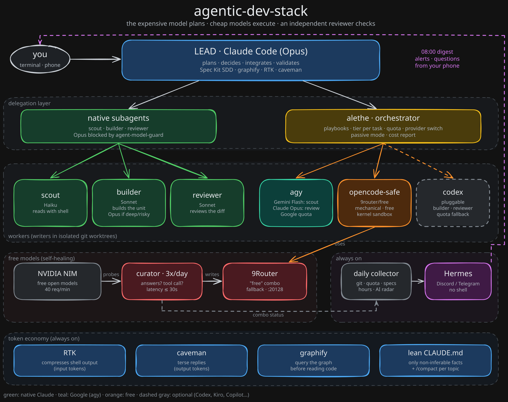

# 01. Architecture: how the stack splits work across models

## The core idea

Every coding agent has the same bottleneck: **one model doing everything, billed at the price of the most expensive model**. Reading 40 files to find where something lives costs the same as deciding the architecture. And while it works, you wait.

This stack splits work by type and routes each type to the cheapest executor that still delivers the quality required:

| Type of work | Needs | Goes to |
|---|---|---|
| Decide, plan, integrate, validate | Strong reasoning, conversation context | Lead (Opus), in your session |
| Read and map lots of code | Volume, not intelligence | Gemini Flash (agy) or Haiku |
| Implement a well-specified unit | Solid execution | Sonnet; Opus for `deep`/`risky` work |
| Review a diff for bugs | An independent pair of eyes | Another provider (agy Opus / Codex) |
| Mechanical edits with automated tests | Almost nothing | Free model (OpenCode + 9Router) |
| Small or tightly coupled task | Context only the lead has | The lead itself (delegating would cost more) |

This is the **plan big, execute small** pattern from Anthropic's cookbooks, extended to several providers.

## Layers



> Editable source: [`assets/architecture.excalidraw`](assets/architecture.excalidraw) (opens in excalidraw.com).

<details>
<summary>Text version</summary>

```
┌─ Layer 1: Lead ────────────────────────────────────────────────────────────┐
│ Claude Code (Opus) · Spec Kit (workflow) · graphify (map) · RTK + caveman  │
└────────────────────────────────────────────────────────────────────────────┘
┌─ Layer 2: Delegation ──────────────────────────────────────────────────────┐
│ Native subagents (scout/builder/reviewer)  │  alethe (CLI orchestrator)    │
│ guarded by agent-model-guard                │  playbooks, quota, report    │
└────────────────────────────────────────────────────────────────────────────┘
┌─ Layer 3: Workers ─────────────────────────────────────────────────────────┐
│ claude -p (Sonnet/Haiku) · agy (Gemini/Claude) · codex · opencode-safe     │
│ every writer in an isolated git worktree; read-only whenever possible      │
└────────────────────────────────────────────────────────────────────────────┘
┌─ Layer 4: Free models ─────────────────────────────────────────────────────┐
│ 9Router ("free" combo, fallback) ← curator 3x/day ← NVIDIA NIM / others    │
└────────────────────────────────────────────────────────────────────────────┘
┌─ Layer 5: Always on ───────────────────────────────────────────────────────┐
│ Hermes Agent (Discord/Telegram, no shell) ← daily collector (script)       │
└────────────────────────────────────────────────────────────────────────────┘
```

</details>

## Token economy layer

Four independent tools attack token spend at four different points of the pipeline. They stack, and none needs the others:

| Tool | What it cuts | Where it acts | Fidelity cost |
|---|---|---|---|
| **RTK** | Input tokens from command output | `PreToolUse(Bash)` hook rewrites `git status` to `rtk git status` and strips noise | None for normal use |
| **caveman** | Output tokens, and the context re-read on every turn | Skill that makes the model answer tersely | None (user-facing replies only; code and commits stay normal) |
| **graphify** | Reading cost | A knowledge graph of the codebase, queried before grep | None |
| **Headroom** (optional) | The whole context window (history, file reads, tool output) | Proxy between Claude Code and the API | Some detail is lost; use for read-heavy sessions only |

In practice: graphify means the agent opens fewer files, RTK shrinks what the shell returns for the files it does open, caveman keeps the replies short, and Headroom (if you enable it) compresses whatever is left. For the day-to-day routine, see [00-smart-vibe-coding.md](00-smart-vibe-coding.md).

## Component by component

### Claude Code (lead)
Your main session, running Opus. It talks to you, holds the context, decides and integrates. The rest of the stack exists so it **spends less**: it does not read 40 files (it sends a scout), does not write boilerplate (it sends a builder/worker), and does not review its own code (it sends a reviewer from another provider).

### Native subagents: `scout`, `builder`, `reviewer`
Defined in `~/.claude/agents/*.md`, with the model pinned in the frontmatter.
- `scout` (haiku): read and search, shell included. Returns a conclusion with `file:line`, never the whole file.
- `builder` (sonnet): executes an already-planned unit, runs the checks, does not commit.
- `reviewer` (sonnet): reads the diff against the acceptance criteria and hunts for bugs without editing.

Use them when the unit needs conversation context or is quick. For several units, workers from other providers or a cost report, use alethe.

### agent-model-guard (hook)
A `PreToolUse` hook on the `Agent` tool, implemented in Node (`hooks/agent-model-guard.mjs`) and registered as `node "~/.claude/hooks/agent-model-guard.mjs"`. Generic subagent types (`general-purpose`, `Explore`, `Plan`) **inherit the session model**, meaning they silently run on Opus. In one real case, 18 of 26 launched subagents ran on Opus even though CLAUDE.md said otherwise. The hook denies:
- a generic type without `model: "haiku"`/`"sonnet"`;
- any explicit `model: "opus"`/`"fable"`;
- `fork` (it always inherits the lead).

The denial message teaches the right call. To pin extra agent names to their own models, list them in `AGENT_GUARD_ALLOW`. For a deliberate exception, start claude with `ALLOW_OPUS_SUBAGENT=1`. As a complement, `CLAUDE_CODE_SUBAGENT_MODEL=sonnet` in `settings.json` makes calls without a model fall back to Sonnet. Note: that env var does **not** affect Explore/Plan unless forced, which is why the hook exists.

### alethe
An orchestration skill (open source, [Kc1t/alethe-orchestrate-skill](https://github.com/Kc1t/alethe-orchestrate-skill)) that runs agent CLIs as workers:
- **Playbooks** (`direct`, `cascade`, `scout-then-build`, `plan-big-execute-small`, `parallel-worktrees`, `plan-execute`, `review-gate`, `best-of-n`...): phases and roles.
- **Profiles** (`base`, `savings`, `aggressive`): which model each tier uses.
- **Quota**: reads Claude/Codex/agy usage and switches provider before you run out.
- **Passive mode** (default): you work normally and it delegates only what becomes cheaper (with a one-line notice). More than 2 parallel workers requires your approval.
- **Report**: `report html` shows workers, models, tokens and cost.

The stack installs a copy **pinned to an audited commit** in `~/.agents/skills/alethe` and symlinks it into each project. Details in [03-alethe.md](03-alethe.md).

### agy (Antigravity CLI)
Google's Antigravity CLI, with a free tier on a Google account. It exposes Gemini Flash and Claude models (Sonnet/Opus) with a **quota separate from your Claude subscription**. In this stack:
- Gemini Flash = read-only scout (cheap, no shell in read mode);
- Claude Opus via agy = independent reviewer.

Two gotchas: agy's Claude models reject `--effort`, and in plan mode agy stops and asks for approval. Both are already handled in the profile and in the briefs.

### OpenCode + `opencode-safe`
An open source agent CLI that talks to any OpenAI-compatible endpoint. Here it uses 9Router's `free` combo (zero cost) for mechanical edits. It always runs:
1. in an **isolated worktree** (`git worktree` does not copy `.env`, which git ignores);
2. inside an OS sandbox that **denies reads** of `.env*`, keys, credentials, `~/.ssh`, `~/.aws` and the Keychain: `sandbox-exec` on macOS (`bin/opencode-safe`), bubblewrap on Linux (`bin/opencode-safe-linux`, installed as `~/.local/bin/opencode-safe`);
3. with `--standalone`, because otherwise `opencode run` delegates tools to a background service that runs **outside** the sandbox.

Windows has no kernel sandbox for this, so the free worker is **disabled by default** there. Setting `ALLOW_UNSANDBOXED_FREE_WORKER=1` creates an **unsandboxed** `opencode-safe.cmd`; prefer WSL2. See [07-security.md](07-security.md) for the leak tests.

### 9Router + curator
9Router is a local router (`http://127.0.0.1:20128/v1`) that merges several free providers into a "combo" with fallback. The problem: free models die without warning (deprecated with 410, per-account 404, 503, timeouts). The **curator** (`scripts/model-curator/curate.py`) runs 3x/day:
- lists NVIDIA's models;
- tests each candidate: does it respond? does it **make a tool call**? latency under 30s?
- ranks by family and speed and writes the best 4 into the combo (with a backup);
- if nothing passes, it **changes nothing**.

9Router starts at login through launchd (macOS), `systemd --user` (Linux) or a Task Scheduler `ONLOGON` task (Windows). See [05-free-models.md](05-free-models.md).

### Spec Kit
A spec-driven workflow ([github/spec-kit](https://github.com/github/spec-kit)): `specify → clarify → plan → tasks → analyze → implement`. Fit with alethe: decision phases stay with the lead; `tasks.md` becomes the units; `[P]` tasks become `parallel-worktrees`; the final diff goes through `review-gate`.

### graphify
Builds a knowledge graph of the code (`graphify-out/`). Scouts run `graphify query "..."` before grep, which means far less reading.

### RTK (Rust Token Killer)
A `PreToolUse(Bash)` hook that rewrites `git status` to `rtk git status` and compresses the output (strips noise from git, ls, tests, docker). Transparent. Measured in real use: 15-30% fewer input tokens. `rtk gain` shows the savings.

### caveman
A skill/plugin that makes the model answer without fluff (`/caveman ultra`). It cuts output tokens and, more importantly, the context that gets re-read every turn. It applies to replies to the user only; briefs, code and commits stay normal.

### Headroom (optional)
A proxy between Claude Code and the API that compresses the entire context (history, file reads, tool output). More savings, but it **loses fidelity** on details. Recommendation: only for read-heavy sessions (`headroom wrap claude`), not for implementing. Telemetry is turned off by the installer.

### Hermes Agent
Nous Research's open source always-on agent, with a gateway to Discord/Telegram/Slack/WhatsApp/Signal, memory, skills and a scheduler. In this stack it **does not code**: it runs without a shell and summarizes data that deterministic scripts collect. See [06-hermes.md](06-hermes.md).

### claude-squad (+ tmux)
For when **you** want to drive several parallel sessions (each in its own worktree) from a TUI. It complements alethe, which is automatic delegation inside one session.

## Scheduled jobs

| Job | macOS | Linux | Windows |
|---|---|---|---|
| Model curator, daily digest | launchd | crontab | Task Scheduler |
| 9Router autostart | launchd | `systemd --user` | `schtasks` ONLOGON |

## Typical feature flow

1. `specify`/`clarify`/`plan`/`tasks`: lead (Opus), with you.
2. Need to understand unfamiliar code? A scout (agy Gemini or the `scout` haiku) maps it, querying graphify.
3. `implement`: alethe shows a `dry-run` (playbook, workers, models, estimate, quota) and waits for your OK:
   - `[P]` tasks go to Sonnet builders in parallel worktrees;
   - renames/i18n/boilerplate with tests go to free opencode (cascade: if the check fails, escalate to Sonnet).
4. The full diff in `.alethe/review.diff` goes to an agy Opus reviewer hunting for bugs; the lead validates and integrates.
5. `report` shows who did what and what it cost.

Next: [02-installation.md](02-installation.md).
