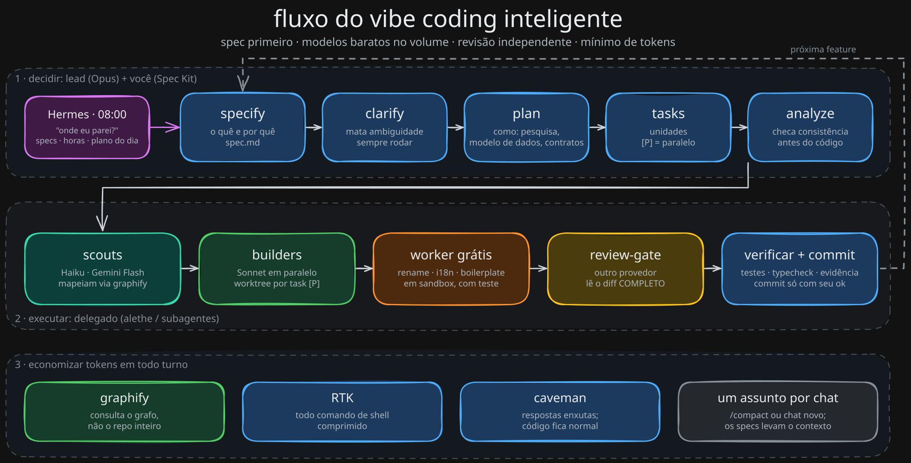

# Vibe coding inteligente: o guia completo

> Você conduz a intenção e as decisões. Os agentes digitam. Este guia é um fluxo diário real no Claude Code: spec primeiro, modelos baratos para o volume, revisão independente, verificação e o mínimo de tokens.



## 1. O que é "vibe coding inteligente"

| Vibe coding burro | Vibe coding inteligente |
|---|---|
| Um agente faz tudo | Lead forte planeja; workers baratos executam em paralelo |
| Prompt gigante, sem spec | Spec primeiro; a spec é o contrato |
| Aceita diff sem olhar | Revisão independente + testes/typecheck |
| Cota acaba antes do almoço | Modelo barato no volume, resposta comprimida, contexto pequeno |
| A memória mora no chat | O estado mora em arquivos (pasta da spec, grafo, CLAUDE.md) |

Seu trabalho: decidir o *quê* e o *porquê*, responder as perguntas do clarify, aprovar planos e conferir evidências. O trabalho dos agentes: ler, digitar, rodar e reportar.

## 2. Os cinco pilares

| Ferramenta | O que economiza | Quando age |
|---|---|---|
| **Spec Kit** (SDD) | Retrabalho, ambiguidade, reexplicar contexto | Antes de qualquer código; toda feature |
| **graphify** | Tokens de leitura (sem grep às cegas nem dump de arquivo) | Sempre que o agente precisa achar ou entender código |
| **RTK** | Tokens da saída do shell (~15-30% da entrada) | Transparente, em todo comando |
| **caveman** | Tokens de saída e o contexto relido a cada turno | Em toda resposta para você |
| **Plan big, execute small** | Tokens do modelo caro e cota | Quando o trabalho é dividido em unidades e delegado |

### 2.1 Desenvolvimento guiado por spec com o GitHub Spec Kit

```
specify -> clarify -> plan -> tasks -> analyze -> implement
```

| Etapa | Produz | Quem |
|---|---|---|
| `specify` | O quê e por quê (histórias, critérios de aceite) | Lead |
| `clarify` | Respostas às dúvidas abertas. **Sempre rode**: mata a ambiguidade antes de virar código | Lead + você |
| `plan` | Como: pesquisa, modelo de dados, contratos | Lead |
| `tasks` | Unidades ordenadas; `[P]` marca as paralelizáveis | Lead |
| `analyze` | Checagem de consistência entre spec, plan e tasks, antes do código | Lead |
| `implement` | O código | **Delegado** aos builders |

As decisões (`specify`, `clarify`, `plan`, `analyze`) ficam com o modelo lead. O `implement` é onde delegar compensa. Uma feature = uma pasta de spec. A spec é o contrato, então um chat novo começa dos arquivos, não da memória: "leia `specs/012-billing/` e continue na task T07".

### 2.2 graphify: consulte antes de dar grep

Um grafo de conhecimento do código vive em `graphify-out/`. Pergunte a ele primeiro:

```bash
graphify query "where is auth handled" --budget 1500
graphify explain SessionStore
graphify path LoginForm AuthService
```

Atualize depois de mudanças estruturais. Os git hooks mantêm o grafo fresco a cada commit.

### 2.3 RTK: saída de shell comprimida

Um hook transparente reescreve `git status` em `rtk git status` e comprime a saída (git, ls, testes, docker) antes de o modelo ver. A economia realista é 15-30% dos tokens de entrada, sem mágica.

```bash
rtk gain          # mede quanto você economizou
rtk proxy <cmd>   # saída crua, sem filtro, quando precisa de cada byte
```

### 2.4 caveman: respostas enxutas

`/caveman ultra` deixa as respostas curtas. Isso corta tokens de saída e, como todo turno relê o histórico, também o contexto. O escopo importa: **só as respostas para você**. Código, mensagem de commit, texto de PR e briefs de worker continuam normais.

### 2.5 Plan big, execute small

| Papel | Modelo | Faz |
|---|---|---|
| Lead | Opus | Planeja, decide, integra, valida |
| Scout | Haiku / Gemini | Lê e mapeia o código |
| Builder | Sonnet | Implementa unidades já planejadas |
| Revisor | Outro provedor | Caça bugs no diff, de forma independente |
| Edição mecânica | Modelos grátis (worktree isolada, sandbox) | Rename, boilerplate, i18n, testes |
| Tarefa pequena ou acoplada | O próprio lead | Delegar custaria mais do que economiza |

Sem enforcement, subagentes genéricos herdam o Opus sem você notar. O hook `agent-model-guard` nega isso, então a regra vale mesmo quando você esquece. Veja [03-alethe.md](03-alethe.md).

## 3. Um dia de trabalho

1. **Abra o projeto.** Ligue `/caveman ultra` (ou deixe automático).
2. **Onde parei?** `"onde eu parei?"` Leia o resumo do Hermes no celular ou veja o status da spec da feature ativa.
3. **Feature nova pelo Spec Kit.**
   ```
   /speckit.specify  Usuário exporta faturas em PDF
   /speckit.clarify
   /speckit.plan
   /speckit.tasks
   /speckit.analyze
   ```

   > O nome dos comandos varia com a versão do Spec Kit e a integração do agente: `/speckit.specify` (atual) ou `/speckit-specify` (instalações via skills). Use o que o seu projeto expõe.

   Responda o clarify você mesmo. São os 10 minutos de maior alavancagem do dia.
4. **Implemente com builders paralelos em worktrees.**
   ```
   Implemente T03 e T04 [P] de specs/012-fatura-pdf/tasks.md.
   Um builder para cada, worktree própria. Scout antes para achar o util de PDF.
   ```
5. **Review gate com o arquivo de diff completo.** O revisor, de outro provedor, recebe a tarefa e o diff inteiro, não o seu resumo:
   ```
   Rode o review-gate no diff de /tmp/fatura-pdf.diff contra os critérios de aceite do spec.md.
   ```
6. **Verifique.** Testes, typecheck e uma execução manual da feature real. Peça a saída, não a afirmação.
7. **Commit só quando você mandar.** Agente nunca commita por conta própria.
8. **Feche o assunto.** `/compact` para seguir no mesmo tema, chat novo para o próximo.

## 4. Padrões de prompt que funcionam

| Padrão | Exemplo |
|---|---|
| Dê o caminho, não o conteúdo | `Leia specs/012-fatura-pdf/spec.md e planeje a T05` |
| Plano antes do código | `Proponha um plano para X. Não edite nada ainda.` |
| Delegação explícita | `Use o scout para mapear o módulo de billing, depois 2 builders em worktrees para T03 e T04, reviewer no diff.` |
| Peça evidência | `Mostre arquivo:linha de cada afirmação e a saída dos testes.` |
| Um assunto por chat | Área nova, chat novo; o estado vai na pasta da spec |
| Pedidos delimitados | `Goal / Owned paths / Check` em todo brief de worker |

## 5. Hábitos de orçamento de tokens

- **CLAUDE.md enxuto**: abaixo de ~150 linhas, só fatos que o agente não infere do código (comandos, pegadinhas, convenções fora do padrão).
- **Leia com offset**: peça a função, não o arquivo. Use o graphify para achar o intervalo de linhas.
- **Não releia arquivo editado**: a ferramenta de edição já dá erro se falhou.
- **Rascunhe o PRD/spec com modelo barato ou grátis** quando a cota está curta; o lead só revisa e decide.
- **`/compact` vs `/clear`**: `/compact` mantém o fio de um assunto; `/clear` (ou chat novo) quando o assunto muda.
- **Chats separados por área**: backend, UI e infra não precisam do contexto um do outro.
- **Meça**: `rtk gain` mostra o que o hook de shell economizou.

## 6. Anti-padrões

| Sintoma | Correção |
|---|---|
| Primeiro prompt gigante com tudo | Prompt curto que aponta para o arquivo da spec |
| Sem spec, "só faz" | `specify` e `clarify`; 10 minutos poupam horas |
| Diff aceito sem testes | Testes/typecheck como gate; revise o diff |
| Subagente rodando em Opus sem você saber | Hook `agent-model-guard`; modelo padrão de subagente = Sonnet |
| Um chat para o projeto inteiro | Um assunto por chat; estado em arquivos |
| Confiar no "DONE" do worker | Confira o diff real e rode o check você mesmo |
| Modelo grátis com acesso ao `.env` | Sandbox de kernel (`opencode-safe`); segredo nunca entra em brief |
| Regra só em texto no CLAUDE.md | Vire hook, sandbox ou política |

## 7. Checklists

**Antes de começar uma feature**
- [ ] Pasta da spec existe; `specify` e `clarify` feitos
- [ ] `plan` e `tasks` revisados; unidades `[P]` são mesmo independentes
- [ ] `analyze` limpo
- [ ] graphify atualizado
- [ ] Chat novo para essa feature

**Antes de dar por pronto**
- [ ] Cada task conferida contra os critérios de aceite da spec
- [ ] Testes e typecheck passam (você viu a saída)
- [ ] Revisão independente do diff completo, achados resolvidos
- [ ] Você rodou a feature real uma vez
- [ ] Sem segredos nem arquivos perdidos no diff

**Fim do dia**
- [ ] Trabalho não commitado foi commitado (por você) ou anotado na pasta da spec
- [ ] Próximo passo escrito no `tasks.md`
- [ ] Grafo atualizado
- [ ] Olhada no `rtk gain`: a cota está onde você esperava?

## 8. Como o stack automatiza isso

| Você quer | Leia |
|---|---|
| As peças e quem faz o quê | [01-arquitetura.md](01-arquitetura.md) |
| Instalação em um comando | [02-instalacao.md](02-instalacao.md) |
| Orquestração, playbooks, review gate | [03-alethe.md](03-alethe.md) |
| Modelos grátis para o trabalho de volume | [05-modelos-gratis.md](05-modelos-gratis.md) |
| Resumo sempre ligado e "onde parei?" | [06-hermes.md](06-hermes.md) |
| Templates de projeto | [`../../templates/pt-BR/project/CLAUDE.md`](../../templates/pt-BR/project/CLAUDE.md), [`../../templates/pt-BR/project/AGENTS.md`](../../templates/pt-BR/project/AGENTS.md) |
