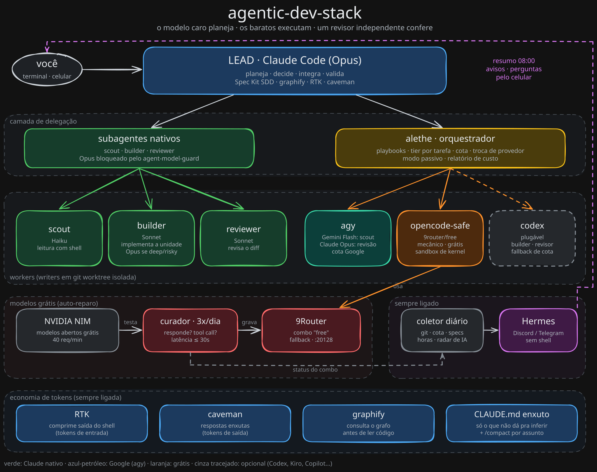

# 01. Arquitetura e papel de cada peça

## A ideia central

Todo agente de código tem o mesmo gargalo: **um modelo só, fazendo tudo, no preço do modelo mais caro**. Ler 40 arquivos para achar onde algo vive custa o mesmo que decidir a arquitetura. E enquanto ele trabalha, você espera.

O stack separa o trabalho por tipo e manda cada tipo para o executor mais barato que entrega a qualidade necessária:

| Tipo de trabalho | Exige | Vai para |
|---|---|---|
| Decidir, planejar, integrar, validar | Raciocínio forte, contexto da conversa | Lead (Opus), na sua sessão |
| Ler e mapear muito código | Volume, não inteligência | Gemini Flash (agy) ou Haiku |
| Implementar uma unidade bem especificada | Boa execução | Sonnet; Opus se for `deep`/`risky` |
| Revisar um diff procurando bugs | Olhar independente | Outro provedor (agy Opus / Codex) |
| Edição mecânica com teste automático | Quase nada | Modelo grátis (OpenCode + 9Router) |
| Tarefa pequena ou acoplada | Contexto que só o lead tem | O próprio lead (delegar sairia mais caro) |

Isso é o padrão **plan big, execute small** dos cookbooks da Anthropic, estendido para vários provedores.

## Camadas



> Fonte editável: [`assets/architecture.excalidraw`](../assets/architecture.pt-BR.excalidraw) (abre em excalidraw.com).

<details>
<summary>Versão em texto</summary>

```
┌─ Camada 1: Lead ───────────────────────────────────────────────────────────┐
│ Claude Code (Opus) · Spec Kit (fluxo) · graphify (mapa) · RTK + caveman    │
└────────────────────────────────────────────────────────────────────────────┘
┌─ Camada 2: Delegação ──────────────────────────────────────────────────────┐
│ Subagentes nativos (scout/builder/reviewer)  │  alethe (orquestrador CLI)  │
│ guardados pelo agent-model-guard              │  playbooks, cota, relatório │
└────────────────────────────────────────────────────────────────────────────┘
┌─ Camada 3: Workers ────────────────────────────────────────────────────────┐
│ claude -p (Sonnet/Haiku) · agy (Gemini/Claude) · codex · opencode-safe     │
│ cada writer em git worktree isolada; read-only quando possível             │
└────────────────────────────────────────────────────────────────────────────┘
┌─ Camada 4: Modelos grátis ─────────────────────────────────────────────────┐
│ 9Router (combo "free", fallback) ← curador 3x/dia ← NVIDIA NIM / outros    │
└────────────────────────────────────────────────────────────────────────────┘
┌─ Camada 5: Sempre ligado ──────────────────────────────────────────────────┐
│ Hermes Agent (Discord/Telegram, sem shell) ← coletor diário (script)       │
└────────────────────────────────────────────────────────────────────────────┘
```

</details>

## Peça por peça

### Claude Code (lead)
Sua sessão principal. Usa Opus. Conversa com você, mantém o contexto, decide e integra. O resto do stack existe para que ele **gaste menos**: não lê 40 arquivos (manda um scout), não escreve boilerplate (manda um builder/worker), não revisa o próprio código (manda um revisor de outro provedor).

### Subagentes nativos: `scout`, `builder`, `reviewer`
Definidos em `~/.claude/agents/*.md`, com o modelo fixado no frontmatter.
- `scout` (haiku): leitura e busca, inclusive com shell. Devolve conclusão com `arquivo:linha`, nunca o arquivo inteiro.
- `builder` (sonnet): executa uma unidade já planejada, roda os checks, não comita.
- `reviewer` (sonnet): lê o diff contra os critérios de aceite e caça bugs, sem editar.

Use quando a unidade precisa do contexto da conversa ou é rápida. Para várias unidades, workers de outro provedor ou relatório de custo, use o alethe.

### agent-model-guard (hook)
`PreToolUse` no tool `Agent`, escrito em Node (`hooks/agent-model-guard.mjs`) e registrado como `node "~/.claude/hooks/agent-model-guard.mjs"`. Os tipos genéricos de subagente (`general-purpose`, `Explore`, `Plan`) **herdam o modelo da sessão**, ou seja, rodam em Opus sem você perceber. Num caso real, 18 de 26 subagentes lançados rodaram em Opus mesmo com o CLAUDE.md mandando o contrário. O hook nega:
- tipo genérico sem `model: "haiku"`/`"sonnet"`;
- qualquer `model: "opus"`/`"fable"` explícito;
- `fork` (sempre herda o lead).

A mensagem de negação ensina o caminho certo. Para fixar outros agentes com modelo próprio, liste-os em `AGENT_GUARD_ALLOW`. Para uma exceção deliberada, abra o claude com `ALLOW_OPUS_SUBAGENT=1`. Complemento: `CLAUDE_CODE_SUBAGENT_MODEL=sonnet` no `settings.json` faz quem não informar modelo cair no Sonnet. Atenção: esse env **não** afeta Explore/Plan sem `_FORCE`, e é por isso que o hook existe.

### alethe
Skill de orquestração (open source, [Kc1t/alethe-orchestrate-skill](https://github.com/Kc1t/alethe-orchestrate-skill)) que roda CLIs de agente como workers:
- **Playbooks** (`direct`, `cascade`, `scout-then-build`, `plan-big-execute-small`, `parallel-worktrees`, `plan-execute`, `review-gate`, `best-of-n`...): fases e papéis.
- **Perfis** (`base`, `savings`, `aggressive`): qual modelo cada tier usa.
- **Cota**: lê o uso do Claude/Codex/agy e troca de provedor antes de estourar.
- **Modo passivo** (padrão): você trabalha normal e ele delega sozinho só o que fica mais barato (avisa em uma linha). Mais de 2 workers em paralelo exige seu ok.
- **Relatório**: `report html` mostra workers, modelos, tokens e custo.

O stack instala uma cópia **fixada num commit auditado** em `~/.agents/skills/alethe` e faz symlink em cada projeto. Detalhes em [03-alethe.md](03-alethe.md).

### agy (Antigravity CLI)
CLI do Google Antigravity. Tem tier grátis com conta Google. Expõe Gemini Flash e modelos Claude (Sonnet/Opus) **com cota separada da sua assinatura Claude**. No stack:
- Gemini Flash = scout de leitura (barato, sem shell no modo leitura);
- Claude Opus via agy = revisor independente.

Duas pegadinhas: modelos Claude do agy recusam `--effort`, e no modo plano o agy para pedindo aprovação. As duas já estão tratadas no perfil e nos briefs.

### OpenCode + `opencode-safe`
CLI de agente open source que fala com qualquer endpoint OpenAI-compatível. Aqui ele usa o combo `free` do 9Router (custo zero) para edições mecânicas. Roda sempre:
1. em **worktree isolada** (o `git worktree` não copia `.env`, que é ignorado pelo git);
2. dentro de um sandbox do sistema que **nega leitura** de `.env*`, chaves, credentials, `~/.ssh`, `~/.aws`, Keychain: `sandbox-exec` no macOS (`bin/opencode-safe`) e bubblewrap no Linux (`bin/opencode-safe-linux`, instalado como `~/.local/bin/opencode-safe`);
3. com `--standalone`, porque sem isso o `opencode run` delega as ferramentas a um serviço de fundo que roda **fora** do sandbox.

No Windows não há sandbox de kernel: o worker grátis fica **desligado por padrão**; `ALLOW_UNSANDBOXED_FREE_WORKER=1` cria um `opencode-safe.cmd` **sem sandbox** (prefira WSL2). Ver [07-seguranca.md](07-seguranca.md) para os testes de vazamento.

### 9Router + curador
O 9Router é um roteador local (`http://127.0.0.1:20128/v1`) que junta vários provedores grátis num "combo" com fallback. O problema: modelos grátis morrem sem aviso (descontinuados com 410, 404 por conta, 503, timeout). O **curador** (`scripts/model-curator/curate.py`) roda 3x/dia:
- lista os modelos da NVIDIA;
- testa cada candidato: responde? **faz tool call**? latência ≤ 30s?
- ordena por família e velocidade e grava os 4 melhores no combo (com backup);
- se nada passar, **não mexe**.

O 9Router sobe no login via launchd (macOS), `systemd --user` (Linux) ou tarefa `ONLOGON` do Agendador de Tarefas (Windows); os agendamentos do curador e do resumo usam launchd, crontab e Agendador de Tarefas, respectivamente. Ver [05-modelos-gratis.md](05-modelos-gratis.md).

### Spec Kit
Fluxo spec-driven ([github/spec-kit](https://github.com/github/spec-kit)): `specify → clarify → plan → tasks → analyze → implement`. Encaixe com o alethe: as fases de decisão ficam no lead; o `tasks.md` vira as unidades; tasks `[P]` viram `parallel-worktrees`; o diff final passa por `review-gate`.

### graphify
Gera um grafo de conhecimento do código (`graphify-out/`). Scouts consultam `graphify query "..."` antes de grep, o que significa muito menos leitura.

### RTK (Rust Token Killer)
Hook `PreToolUse(Bash)` que reescreve `git status` → `rtk git status` e comprime a saída (remove ruído de git, ls, testes, docker). Transparente. Medido em uso real: 15–30% menos tokens de entrada. `rtk gain` mostra a economia.

### caveman
Skill/plugin que faz o modelo responder sem enrolação (`/caveman ultra`). Corta tokens de saída e, mais importante, o contexto que é relido a cada turno. Vale só para respostas ao usuário; briefs, código e commits ficam normais.

### Headroom (opcional)
Proxy entre o Claude Code e a API que comprime o contexto inteiro (histórico, arquivos lidos, saídas de ferramenta). Mais economia, mas **perde fidelidade** em detalhes. Recomendação: só em sessões de leitura pesada (`headroom wrap claude`), não para implementar. Telemetria desligada pelo instalador.

### Hermes Agent
Agente open source da Nous Research, sempre ligado, com gateway para Discord/Telegram/Slack/WhatsApp/Signal, memória, skills e agendador. No stack ele **não programa**: roda sem shell e resume dados que scripts determinísticos coletam. Ver [06-hermes.md](06-hermes.md).

### claude-squad (+ tmux)
Para quando **você** quer pilotar várias sessões em paralelo (cada uma em worktree) num TUI. Complementa o alethe, que é delegação automática dentro de uma sessão.

## Fluxo típico de uma feature

1. `specify`/`clarify`/`plan`/`tasks`: lead (Opus), com você.
2. Precisa entender código desconhecido? Scout (agy Gemini ou `scout` haiku) mapeia, consultando o graphify.
3. `implement`: o alethe mostra `dry-run` (playbook, workers, modelos, estimativa, cota) e espera seu ok:
   - tasks `[P]` → builders Sonnet em worktrees paralelas;
   - renames/i18n/boilerplate com teste → opencode grátis (cascade: se falhar o check, escala para Sonnet).
4. Diff completo em `.alethe/review.diff` → revisor agy Opus caça bugs → lead valida e integra.
5. `report` mostra quem fez o quê e quanto custou.
